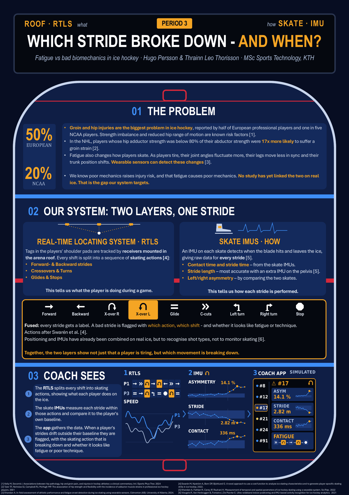
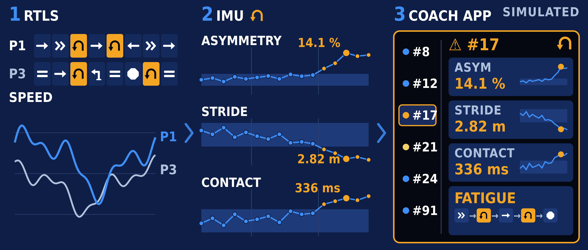

# Which Stride Broke Down – and When?
### Fatigue vs bad biomechanics in ice hockey

**Hugo Persson & Thrainn Leo Thorisson** · MSc Sports Technology, KTH Royal Institute of Technology

A concept for a system that shows ice hockey coaches **which skating movement breaks down, and when**, so that fatigue-related changes in technique can be caught before they turn into groin, hip or knee injuries.

> [!NOTE]
> Concept based on desktop research. All example data shown is simulated.

## Poster

<p align="center">
  <a href="Poster_A_Down_the_Ice_A1.pdf">
    
  </a>
  <br>
  <em>Click the poster to open the full-resolution A1 PDF.</em>
</p>

## System output



---

## Files

| File | Description |
|---|---|
| [`Poster_A_Down_the_Ice_A1.pdf`](Poster_A_Down_the_Ice_A1.pdf) | Scientific poster (A1, 594 × 841 mm) |
| [`Project_Description.pdf`](Project_Description.pdf) | Full project description with background, system design, limitations and references |

---

## The problem

- **Groin and hip injuries are the biggest injury problem in ice hockey.** Half of European professional players and one in five NCAA players report them as the dominant problem [1].
- **Hip imbalance raises injury risk.** NHL players whose hip adductor strength was below 80% of their abductor strength were **17× more likely** to suffer a groin strain [2].
- **Fatigue changes how players skate.** As players tire, joint angles fluctuate more, the legs move less in sync and the trunk position shifts [3].
- **Today's technology doesn't show *how* players skate in games.** Commercial wearables track speed and load. Cameras struggle with bulky equipment. Skate IMUs have only been validated in a lab, on synthetic ice and forward skating [4].

No study has yet linked fatigue-driven technique changes to injury on real ice. **That is the gap this project targets.**

---

## The system: two layers, one stride

```
  ROOF · RTLS                SKATE · IMUs                 COACH APP
  what the player does  →    how each stride looks   →    flag + advice
  ─────────────────────      ─────────────────────        ─────────────────────
  Receivers in the arena     One IMU per skate:           Each stride compared
  roof track a tag in the    contact time, stride         with the player's own
  shoulder pads. Every       time, stride length and      rested baseline.
  shift is split into        left/right asymmetry [4]     Fatigue or technique?
  skating actions [5]
```

1. **RTLS (Real-Time Locating System)** splits every shift into a sequence of skating actions.
2. **Skate IMUs** detect when the blade hits and leaves the ice, giving raw data for every stride.
3. **Fusion** labels each stride with its action. When strides drift outside the player's own baseline, the app flags **which action, which shift**, and whether it looks like **fatigue or poor technique**.

### Skating actions

Based on the skating characteristics defined by Swarén et al. [5]:

| Action | Description |
|---|---|
| Forward | Forward skating, alternating skates |
| Backward | Backward skating, all types |
| Crossover right / left | Crossovers in either direction |
| Glide | No active speed generation |
| C-cuts | C-cuts forward |
| Sharp turn left / right | Turns with speed loss |
| Stop | Full stop |

---

## What the coach sees *(simulated example)*

Player **#17**, period 3, shift 14, **crossover left**:

| Metric | Value | Rested baseline | Change |
|---|---|---|---|
| Left/right asymmetry | 14.1% | 3–7% | +7.1 pp |
| Stride length | 2.82 m | 3.09 m | −9% |
| Contact time | 336 ms | 311 ms | +8% |

**Classification:** fatigue → **Advice:** shorter shifts and a personal 15-second crossover drill.

---

## Limitations

- Not yet validated on real ice, at game speed or for movements other than forward skating.
- Single-stride measurement errors are similar in size to the asymmetry we want to detect, so the system relies on averaging and personal baselines.
- Skate IMUs measure the feet, not the hip or knee directly.
- RTLS requires receivers installed in the arena.

## Next steps

1. Validate the skate IMUs on real ice for every skating action.
2. Define what normal left/right asymmetry is for each action.
3. Run a prospective study linking low, normal and high asymmetry to groin, hip and knee pain.
4. If asymmetry predicts injury, build the coach app.

---

## References

1. Kelly M, Secomb J. Associations between hip pathology, hip and groin pain, and injuries in hockey athletes: a clinical commentary. Int J Sports Phys Ther. 2024;19(5):625-41.
2. Tyler TF, Nicholas SJ, Campbell RJ, McHugh MP. The association of hip strength and flexibility with the incidence of adductor muscle strains in professional ice hockey players. Am J Sports Med. 2001;29(2):124-8.
3. Khandan A. In-field assessment of athletic performance and fatigue onset detection during ice skating using wearable sensors [dissertation]. Edmonton (AB): University of Alberta; 2024.
4. Khandan A, Fathian R, Carey JP, Rouhani H. Measurement of temporal and spatial parameters of ice hockey skating using a wearable system. Sci Rep. 2022;12(1):22280.
5. Swarén M, Nyström A, Born DP, Björklund G. A novel approach to use a cost function to analyse ice skating characteristics and to generate player-specific skating drills in ice hockey. In: Proceedings of the 9th International Performance Analysis Workshop and Conference & 5th IACSS Conference; 2022.

The full reference list is in the project description.

---

*MSc Sports Technology · KTH Royal Institute of Technology · 2026*

